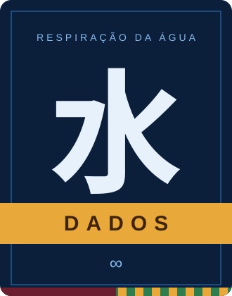
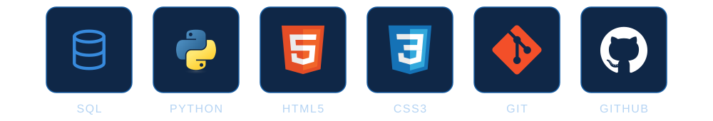

<!-- ============ BANNER (a faixa do haori já faz parte da imagem) ============ -->

  

<h3 align="center">🟢 Aberto a oportunidades de estágio em Dados e Front-end</h3>

<b>DISCIPLINA CONSTANTE. SEM ATALHOS.</b> Entre consultas, scripts e interfaces, eu sigo em frente.

<!-- ============ GIF DO GIYU (suba o arquivo como assets/giyu.gif) ============ -->

  

Calma na postura. Força nos estudos. Constância pra próxima missão.

<!-- ============ BOTÕES ============ -->

  
  
  
  <!-- Quando o currículo estiver pronto: veja o comentário no fim do arquivo -->
  

 

<!-- ============ 01 ============ -->

  <picture>
    <source media="(prefers-color-scheme: light)" srcset="assets/tags/01-sobre-mim-claro.svg">
    
  </picture>

Sou estudante de **Análise e Desenvolvimento de Sistemas na FIAP** (modalidade EAD, com previsão de conclusão em 2027) e busco meu **primeiro estágio** nas áreas de **Dados** e **Front-end**. Gosto de transformar problemas reais em soluções organizadas e bem apresentadas, e uso o GitHub para documentar minha evolução, um projeto de cada vez.

- 📊 **Dados:** estudo **SQL** e programação de banco de dados (**PL/SQL**) na faculdade, com foco em consultas e na organização das informações.
- 🐍 **Python:** tenho base sólida na linguagem e quero aplicá-la em análise de dados.
- 🎨 **Front-end:** construo páginas e interfaces com **HTML e CSS**, cuidando de layout e identidade visual.
- 🎯 **Objetivo:** aplicar o que aprendo em um time real, com acompanhamento, e crescer na área.

 

<table width="100%">
  <tr><th align="left" width="30%">Procuro</th><td>Estágio em <b>Dados</b> (SQL e Python) ou em <b>Front-end</b> (HTML e CSS)</td></tr>
  <tr><th align="left">Formação</th><td>Análise e Desenvolvimento de Sistemas · FIAP</td></tr>
  <tr><th align="left">Localização</th><td>São Paulo, SP</td></tr>
  <tr><th align="left">Disponibilidade</th><td><i>escreva aqui (presencial, híbrido ou remoto, e horário)</i></td></tr>
</table>

 

<!-- ============ 02 ============ -->

  <picture>
    <source media="(prefers-color-scheme: light)" srcset="assets/tags/02-principais-tecnologias-claro.svg">
    
  </picture>

  

 

<!-- ============ 03 ============ -->

  <picture>
    <source media="(prefers-color-scheme: light)" srcset="assets/tags/03-projetos-em-destaque-claro.svg">
    
  </picture>

<table width="100%">
  <tr><th align="left" width="30%">Projeto</th><th align="left">O que você vai encontrar</th></tr>
  <tr><td><a href=https://gustavosp4591-lab.github.io/portfolio/><b>Meu portfólio</b></a></td><td>Meu site pessoal, com apresentação profissional, projetos e identidade visual própria.</td></tr>
</table>

Em desenvolvimento: novos projetos de Dados e Front-end, adicionados aqui assim que forem concluídos.

 

<!-- ============ 04 ============ -->

  <picture>
    <source media="(prefers-color-scheme: light)" srcset="assets/tags/04-trilha-das-formas-claro.svg">
    
  </picture>

<table width="100%">
  <tr><th align="left" width="22%">Nível</th><th align="left" width="34%">Tecnologias</th><th align="left">Como estou praticando</th></tr>
  <tr><td><b>Dominando</b></td><td>HTML, CSS, Python</td><td>Base sólida, que uso nos meus estudos e no meu portfólio.</td></tr>
  <tr><td><b>Treinando</b></td><td>SQL, PL/SQL, Java</td><td>Em prática nas disciplinas de banco de dados e programação da FIAP.</td></tr>
  <tr><td><b>Próxima forma</b></td><td><i>escreva aqui</i></td><td><i>escreva aqui como você pretende aprender</i></td></tr>
</table>

 

<!-- ============ 05 ============ -->

  <picture>
    <source media="(prefers-color-scheme: light)" srcset="assets/tags/05-estatisticas-claro.svg">
    
  </picture>

  
  

<picture>
  <source media="(prefers-color-scheme: dark)" srcset="https://raw.githubusercontent.com/gustavosp4591-lab/gustavosp4591-lab/output/galaga-contribution-graph-dark.svg">
  <source media="(prefers-color-scheme: light)" srcset="https://raw.githubusercontent.com/gustavosp4591-lab/gustavosp4591-lab/output/galaga-contribution-graph.svg">
  
</picture>

 

<!-- ============ 06 ============ -->

  <picture>
    <source media="(prefers-color-scheme: light)" srcset="assets/tags/06-em-constante-evolucao-claro.svg">
    
  </picture>

<table width="100%">
  <tr><th align="left" width="30%">Formação</th><td><b>Análise e Desenvolvimento de Sistemas</b> · FIAP · em andamento, previsão de conclusão em 2027</td></tr>
  <tr><th align="left">Estudando agora</th><td>SQL e PL/SQL (banco de dados) · Java · aprofundando HTML, CSS e Python</td></tr>
  <tr><th align="left">Próximos passos</th><td><i>escreva aqui (por exemplo: concluir o primeiro projeto de Dados e publicá-lo aqui)</i></td></tr>
</table>

 

<!-- ============ CONTATO ============ -->

  <b>Vamos conversar?</b> Estou aberto a estágio em Dados e Front-end. 
  <a href="https://www.linkedin.com/in/gustavo-dacruz-92279437b">LinkedIn</a> ·
  <a href=https://gustavosp4591-lab.github.io/portfolio/>Portfólio</a> ·
  <a href="mailto:gustavo.sp4591@gmail.com">E-mail</a>

<!-- ============ RODAPÉ (a faixa do haori já faz parte da imagem) ============ -->

  

<!--
BOTÃO DO CURRÍCULO (quando o PDF estiver pronto):
1. Suba o PDF na pasta assets (ex.: assets/curriculo-gustavo.pdf)
2. Apague a linha  lá em cima
3. No lugar, coloque:
   
-->
