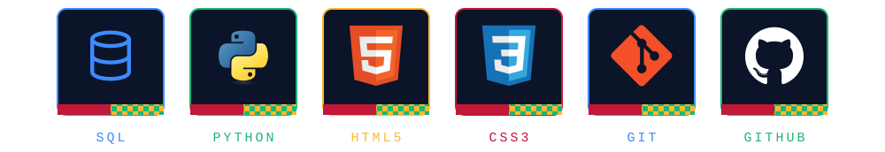

<!-- ============ BANNER (a faixa do haori já faz parte da imagem) ============ -->

  

<!-- ============ TEXTO DIGITANDO ============ -->

  

<h3 align="center">● Aberto a oportunidades de estágio em Dados e Front-end</h3>

<!-- ============ GIF DO GIYU (assets/giyu.gif) ============ -->

  

Calma na postura. Força nos estudos. Constância pra próxima missão.

<!-- ============ BOTÕES ============ -->

  
  
  <!-- Quando o currículo estiver pronto: veja o comentário no fim do arquivo -->
  

<!-- ============ NAVEGAÇÃO (clique para ir até a seção) ============ -->

  
  
  
  
  
  

 

<!-- ============ 01 ============ -->

Olá! Sou o Gustavo.

▸ Estudante de **Análise e Desenvolvimento de Sistemas** na FIAP.

▸ Estou desenvolvendo minhas habilidades em SQL, Python e bancos de dados relacionais, com foco em consultas, análise e organização de dados.

▸ Atualmente, estudo modelagem de dados, consultas SQL e programação com Python por meio de exercícios e projetos práticos.

▸ Meu objetivo é conquistar uma oportunidade de estágio em Dados ou Banco de Dados, contribuir com uma equipe e continuar evoluindo como desenvolvedor.

Tecnologias em estudo: SQL e Python. Também tenho experiência acadêmica com HTML, CSS e construção de interfaces.

 

<table width="100%">
  <tr><th align="left" width="30%">Procuro</th><td>Estágio em <b>Dados</b> (SQL e Python) ou em <b>Front-end</b> (HTML e CSS)</td></tr>
  <tr><th align="left">Formação</th><td>Análise e Desenvolvimento de Sistemas · FIAP</td></tr>
  <tr><th align="left">Localização</th><td>São Paulo, SP</td></tr>
  <tr><th align="left">Disponibilidade</th><td>Híbrido</td></tr>
</table>

 

<!-- ============ 02 ============ -->

  

 

<!-- ============ 03 ============ -->

<table width="100%">
  <tr><th align="left" width="30%">Projeto</th><th align="left">O que você vai encontrar</th></tr>
  <tr><td><a href="https://gustavosp4591-lab.github.io/portfolio/"><b>Meu portfólio</b></a></td><td>Meu site pessoal, com apresentação profissional, projetos e identidade visual própria.</td></tr>
</table>

Em desenvolvimento: novos projetos de Dados e Front-end, adicionados aqui assim que forem concluídos.

 

<!-- ============ 04 ============ -->

  

👇 Clique em cada forma para abrir.

<b>1ª Forma · SQL e bancos de dados</b>

 
Estudo modelagem de dados e consultas SQL por meio de exercícios.
  

<b>2ª Forma · Python</b>

 
Base sólida na linguagem, que uso nos meus estudos. Quero aplicá-la em análise de dados.
  

<b>3ª Forma · HTML e CSS</b>

 
Construo páginas e interfaces, e uso essas habilidades no meu portfólio.
  

<b>4ª Forma · a próxima</b>

 
<i>escreva aqui o que você vai aprender depois</i>
  

 

<!-- ============ 05 ============ -->

  
  

<picture>
  <source media="(prefers-color-scheme: dark)" srcset="https://raw.githubusercontent.com/gustavosp4591-lab/gustavosp4591-lab/output/galaga-contribution-graph-dark.svg">
  <source media="(prefers-color-scheme: light)" srcset="https://raw.githubusercontent.com/gustavosp4591-lab/gustavosp4591-lab/output/galaga-contribution-graph.svg">
  
</picture>

 

<!-- ============ 06 ============ -->

  

 

<!-- ============ 07 ============ -->
<!-- Se você ainda não tem certificados, apague esta seção inteira (do comentário 07 até o próximo  ). -->

<table width="100%">
  <tr><th align="left" width="46%">Certificado</th><th align="left" width="34%">Instituição</th><th align="left">Ano</th></tr>
  <tr><td><i>escreva aqui o nome do certificado</i></td><td><i>escreva aqui</i></td><td><i>----</i></td></tr>
</table>

 

<!-- ============ CONTATO ============ -->

  <b>Vamos conversar?</b> Estou aberto a estágio em Dados e Front-end. 
  <a href="https://www.linkedin.com/in/gustavo-dacruz-92279437b">LinkedIn</a> ·
  <a href="https://gustavosp4591-lab.github.io/portfolio/">Portfólio</a> ·
  gustavo.sp4591@gmail.com

<!-- ============ RODAPÉ (a faixa do haori já faz parte da imagem) ============ -->

  

<!-- ============ CRÉDITOS ============ -->

🎨 Créditos visuais

- Arte do Giyu e GIF: **[escreva a ferramenta de IA e a fonte do GIF]**.
- Ícones de tecnologia: [Devicon](https://devicon.dev/). Badges: [Shields.io](https://shields.io/). Jogo animado: [pacman-contribution-graph](https://github.com/abozanona/pacman-contribution-graph).
- O tema é inspirado no Giyu Tomioka, personagem de *Demon Slayer*, de Koyoharu Gotouge. Projeto de fã, sem fins comerciais.

<!--
BOTÃO DO CURRÍCULO (quando o PDF estiver pronto):
1. Suba o PDF na pasta assets (ex.: assets/curriculo-gustavo.pdf)
2. Apague a linha  lá em cima
3. No lugar, coloque:
   
-->
