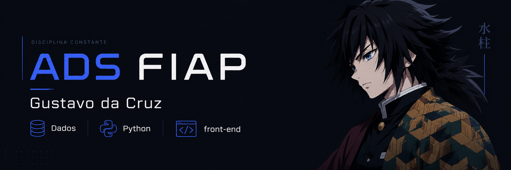
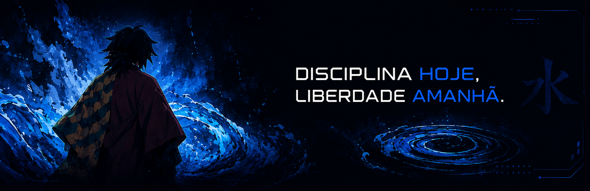

<!-- ============ BANNER + FAIXA DO HAORI ============ -->

  

  

<!-- ============ STATUS (texto de verdade, lido por busca) ============ -->
<h3 align="center">🟢 Aberto a estágio em Dados e Front-end</h3>

<!-- ============ GIF DO GIYU ============ -->

  

Calma na postura. Força nos estudos. Constância pra próxima missão.

<!-- ============ BOTÕES ============ -->

  
  
  
  <!-- Quando o currículo estiver pronto: troque a linha abaixo pela versão com link (veja o comentário no fim do arquivo) -->
  

 

<!-- ============ 01 ============ -->

Estudante de **Análise e Desenvolvimento de Sistemas na FIAP**, buscando o primeiro estágio em **Dados** ou **Front-end**. Aqui eu registro minha evolução, um projeto por vez.

 

<!-- ============ 02 ============ -->

  
  
  
  
  
  

 

<!-- ============ 03 ============ -->

| Nível | O que estou estudando |
|---|---|
| **Dominando** | HTML, CSS, Python |
| **Treinando** | SQL, PL/SQL, Java (FIAP) |
| **Próxima forma** | _escreva aqui o que você vai aprender depois_ |

 

<!-- ============ 04 ============ -->

| Projeto | O que você vai encontrar |
|---|---|
| [**Meu portfólio**](SEU_LINK_DO_PORTFOLIO) | _escreva aqui uma frase sobre o seu portfólio_ |

Novas missões entram aqui conforme eu concluir.

 

<!-- ============ 05 ============ -->

  
  

 

<!-- ============ RODAPÉ ============ -->

  

  

<!-- ============ CRÉDITOS VISUAIS ============ -->

🎨 Créditos visuais

- Banner e rodapé: imagens geradas com **[escreva a ferramenta de IA que você usou]**.
- GIF: **[escreva a fonte do GIF]**.
- Giyu Tomioka é personagem de *Demon Slayer*, de Koyoharu Gotouge. Projeto de fã, sem fins comerciais.

<!--
BOTÃO DO CURRÍCULO (para usar quando o PDF estiver pronto):
1. Suba o PDF na pasta assets (ex.: assets/curriculo-gustavo.pdf)
2. Apague a linha  lá em cima
3. No lugar, coloque:
   
-->
